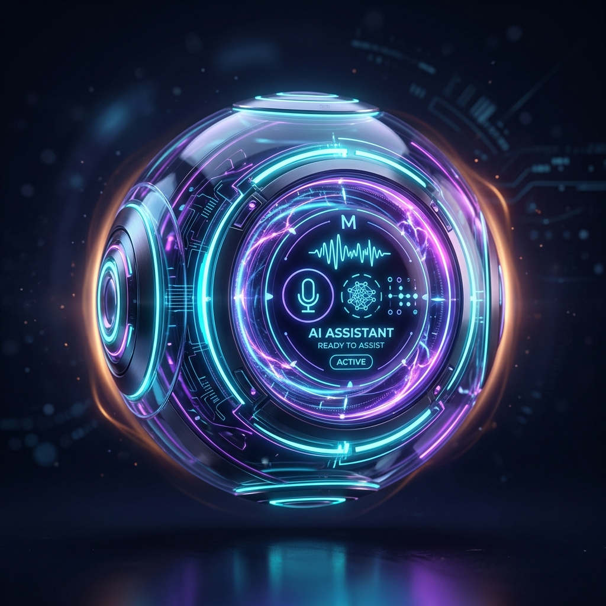

# 🌌 ZENITH ASSISTANT — Next-Gen Multimodal AI Assistant

A high-performance, full-stack multimodal AI chatbot powered by Google Gemini, with support for **Text**, **Image Generation**, **Vision & Images**, **Live Camera Snapshots**, **Voice Dictation**, **Audio Waveforms**, **Text-to-Speech (TTS)**, and **Document Intelligence**.



---

## ⚡ Core Features

- 🖼️ **Vision & Image Understanding**: Drag and drop images (PNG, JPEG, WEBP) or screenshots directly into the chat for detailed structural, aesthetic, and OCR analysis. Click any image to view it full screen in the lightbox.
- 🎨 **Image Generation**: Choose **Generate Image** or ask the chatbot to create an image from a prompt. Generated images appear in the conversation with a download link; optional JPEG, PNG, and WEBP reference images can guide generation.
- 📷 **Live Camera Snapshot**: Capture real-world photos directly from your webcam with a single tap and analyze them instantly.
- 🎙️ **Voice & Audio Dictation**: Speech-to-text recognition with a real-time reactive soundwave frequency visualizer.
- 🔊 **Text-to-Speech (TTS) Readout**: Listen to assistant responses in natural spoken voices with customizable pitch, speed, and auto-read toggle.
- 📄 **Document Intelligence**: Upload PDFs, TXT, CSV, JSON, and source code files for deep semantic Q&A and summary tables.
- 🌊 **Real-Time Streaming**: Server-Sent Events (SSE) deliver character-by-character streaming responses with typing cursor and instant stop-generation controls.
- 💻 **Syntax-Highlighted Code Blocks**: Clean dark code presentation with language tags and one-click copy buttons.
- 🎨 **Sleek Glassmorphic Design**: Curated dark palettes (Obsidian Dark, Cyberpunk Neon, Deep Midnight, Glass Light) with neon glows, micro-animations, and responsive mobile/desktop layout.
- ⚙️ **Customizable AI Personas & Temperature**: Choose between Multimodal Genius, Senior Software Architect, Document Analyst, Creative Storyteller, or custom system instructions.
- 🔑 **Gemini API Setup**: Add and validate a Gemini API key in Settings. Chat and image generation use the configured Gemini project.

---

## 🚀 Getting Started

### 1. Configure Environment
Copy `.env.example` to `.env` or enter your Gemini API key inside the UI **Settings (⚙️)**:
```env
GEMINI_API_KEY=your_gemini_api_key_here
PORT=3000
```
Create a key in [Google AI Studio](https://aistudio.google.com/app/apikey).

Chat uses Gemini's streaming Interactions API for text and vision. Image generation uses Gemini's Nano Banana Interactions API with available model fallback. User prompts and explicit styles are passed through; when no style is specified, photorealism is used by default.

### 2A. Run with Node.js (Production Server)
```bash
npm install
npm start
```

### 2B. Run with Python FastAPI
```bash
pip install -r requirements.txt
python app.py
```

Open your browser and navigate to:
```
http://localhost:3000
```

### 3. Standalone Python Multimodal CLI
```bash
# Interactive terminal session
python multimodal_cli.py --interactive

# Analyze an image directly from terminal
python multimodal_cli.py --image path/to/image.png --prompt "Analyze this image"
```

---

## 🚢 Production Deployment

### 🐳 Docker & Docker Compose
To run in containerized production with auto-restart and health checks:
```bash
docker compose up -d --build
```

### ⚡ PM2 Process Manager
For high-availability clustering and process management:
```bash
npm install -g pm2
pm2 start ecosystem.config.js --env production
```

### 🩺 Health Checks
The production server exposes automated health monitoring endpoints:
* `GET /api/health`
* `GET /healthz`

Response:
```json
{
  "status": "healthy",
  "uptime": 120,
  "timestamp": "2026-10-28T06:43:35.794Z",
  "service": "mm-chatbot",
  "version": "1.0.0"
}
```

---

## 🛠️ Tech Stack
- **Backend**: Node.js, Express, CORS, SSE (Server-Sent Events), native `fetch` streaming
- **Frontend**: Vanilla HTML5, Vanilla CSS3 Design System with CSS variables and glassmorphism, Modular Vanilla JavaScript
- **Libraries**: Marked.js (Markdown), Highlight.js (Code Highlighting), Web Speech API, Web Audio API (Waveform visualizer), MediaDevices (Webcam)
